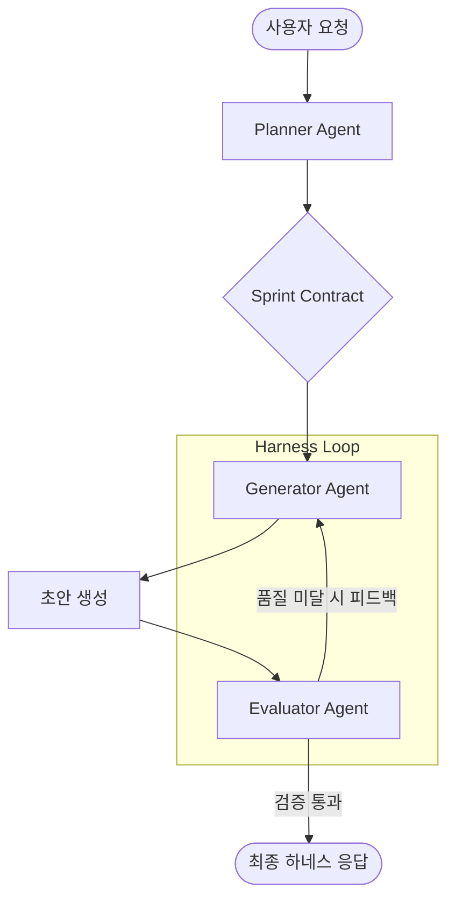

# ANI 프로젝트 하네스 엔지니어링 기술 명세 (Harness Engineering Spec)

본 문서는 Anthropic 및 OpenAI의 하네스 설계 방법론을 ANI 프로젝트의 AI 데이트 플래너 및 비서 기능에 적용하기 위한 기술 구조를 정의합니다.

## 1. 하네스 아키텍처 개요 (Multi-Agent Loop)

기존의 단일 에이전트 방식에서 벗어나, 3단계의 독립된 에이전트 루프를 구축하여 응답의 품질과 신뢰성을 보장합니다.

## 2. 에이전트별 세부 역할 (Personas)

### 2.1 Planner Agent (기획 및 상호협의)
- **입력**: 사용자의 짧은 요청 (예: "강남역 주변 맛집 포함 알찬 데이트 코스 짜줘")
- **출력**: 상세 스펙 및 **Sprint Contract**
- **기능**:
    - 요청의 의도를 파악하여 구체적인 제약 사항 정의 (예: 동선 최적화, 특정 음식 제외 등).
    - Evaluator가 검증할 수 있는 '성공 기준(Criteria)' 정의.

### 2.2 Generator Agent (구축 및 구현)
- **입력**: Planner가 작성한 Sprint Contract
- **출력**: 데이트 코스 계획, 감성 피드백, 또는 UI 구성안
- **기능**:
    - 계약 조건에 맞게 최적의 결과 도출.
    - 자기 스스로는 알지 못하는 'AI 전형성(Generic Patterns)' 탈피 시도.

### 2.3 Evaluator Agent (QA 및 품질 평가)
- **입력**: Generator의 출력물 + Sprint Contract
- **출력**: 점수(Pass/Fail) 및 개선 피드백
- **평가 지표 (Anthropics 기준 준용)**:
    - **디자인 품질(Aesthetics)**: 제안된 계획이 얼마나 매력적이고 세련되었는가?
    - **논리적 정성(Craft)**: 이동 동선이 현실적인가? 장소간 거리가 적절한가?
    - **기능성(Functionality)**: 영업 시간, 예약 필요성 등 필수 정보가 포함되었는가?
    - **독창성(Originality)**: 흔한 'AI 추천 코스'가 아닌, ANI만의 특별함이 느껴지는가?

## 3. 기술 스택 및 구현 방식

- **LLM**: Google Gemini 2.5 Flash (루프 반복 시 효율적 비용 및 속도 제공)
- **자동화 검증**:
    - **Playwright MCP**: UI 구성 요소가 포함된 경우 실제 렌더링 후 캡처하여 시각적 검증 수행.
    - **Google Maps API**: 제안된 장소의 실제 데이터(영업 시간, 평점 등)를 교차 검증.

## 4. 기대 효과
- 사용자가 "다시 짜줘"라고 말하기 전에, AI가 내부적으로 최선의 코스를 이미 3~5회 반복 검증하여 최상의 완성도로 제공.
- ANI 앱의 프리미엄 이미지 구축 및 사용자 유지율(Retention) 향상.
